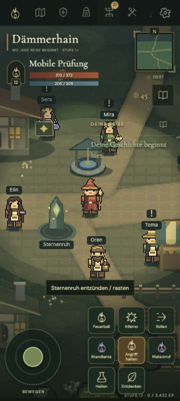
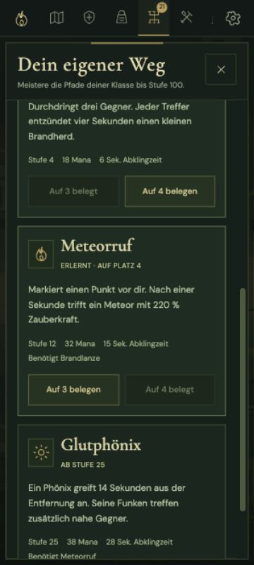

# Mobile, Skills und Ausrüstung – Version 2.2

Browserprüfung am 13. Oktober 2026 gegen einen separaten lokalen Testserver. Die vorhandenen Spielstände und Multiplayer-Reiche wurden nicht durch Testdaten ersetzt.

## Geprüfte Abläufe

- Hochformat 390 × 844 und 360 × 800 sowie Querformat 844 × 390: Dokumentbreite und -höhe entsprechen dem Viewport, ohne Seitenüberlauf. Das Skillmenü scrollt innerhalb des Fensters. Im Querformat liegen die acht Aktionen in zwei Reihen.
- Alle acht Menüs lassen sich auf kleinen Handys auch über die Einstellungen öffnen. Der Weg Einstellungen → Gruppe wurde direkt im Browser geprüft.
- Flammenrufer auf Stufe 12: Brandlanze für einen und Meteorruf für zwei Talentpunkte gelernt, automatisch auf 3/4 gelegt. Glutphönix bleibt mit der Voraussetzung Stufe 25 gesperrt.
- Beide gelernten Fähigkeiten über ihre Touchbuttons ausgeführt: Mana wird verbraucht und der Button zeigt seine Abklingzeit. Joystick und Halteangriff wurden über Browser-Eingaben bedient.
- Epischen Stufe-12-Zauberstab im Inventar angelegt: Zauberkraft 88,2 → 163,35. Mit seltener Rüstung und Amulett: Zauberkraft 174,44, maximale Lebenspunkte 230,4 → 372,02. Der Vergleich zeigt die tatsächlichen Gesamtwerte einschließlich negativer Änderungen.
- Waffe in der Charakteransicht abgelegt und denselben Gegenstand wieder im Inventar angelegt. Der Gegenstand bleibt erhalten; Ablegen entfernt seine Werte. Das Anlegen zusätzlicher Lebenspunkte füllt das aktuelle Leben nicht auf.
- Ein Stufe-40-Stab bleibt auf Stufe 12 gesperrt. Lernen, Skillplätze und Ausrüstung sind nach Neuladen und „Gespeicherte Reise fortsetzen“ erhalten.
- Keine aufgezeichneten Browserwarnungen oder JavaScriptfehler während dieser Abläufe.

## Grenzen dieser Prüfung

Die Browseransicht prüft responsive Layouts und echte UI-Aktionen mit Zeigereingaben. Gleichzeitige Finger, Pointer-Capture, Abbruch und Freigabe werden zusätzlich mit dem Eingabeadapter getestet. Ein physisches iOS-/Android-Gerät sowie Safari wurden in dieser Prüfung nicht benutzt; Geräteperformance und Betriebssystemgesten benötigen weitere Gerätetests.

Die Balancewerte sind reproduzierbare Modellvergleiche und Integrationstests, keine abgeschlossene Langzeitbalance. Annahmen und Ergebnisse stehen im [Balancebericht](balance-report.md).

