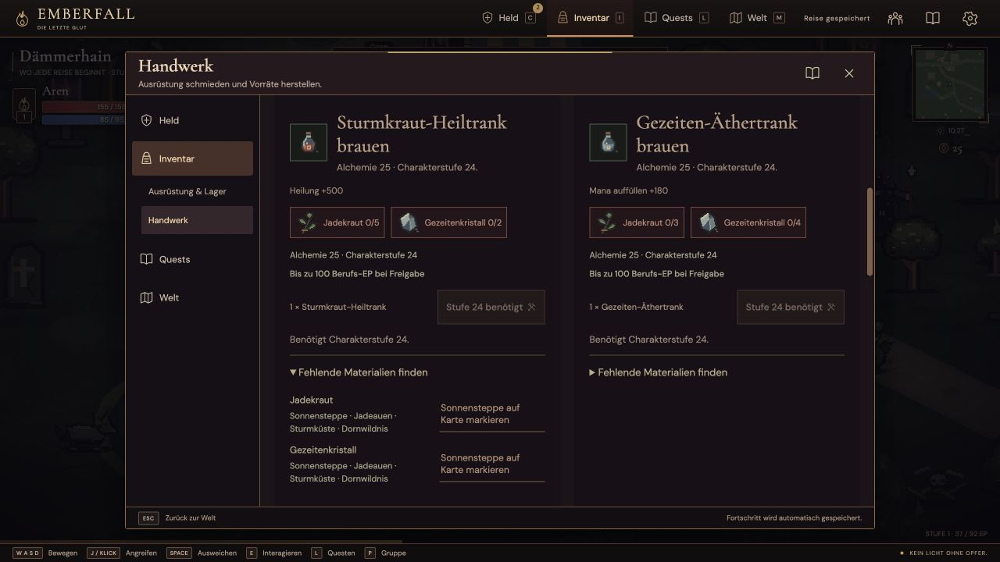
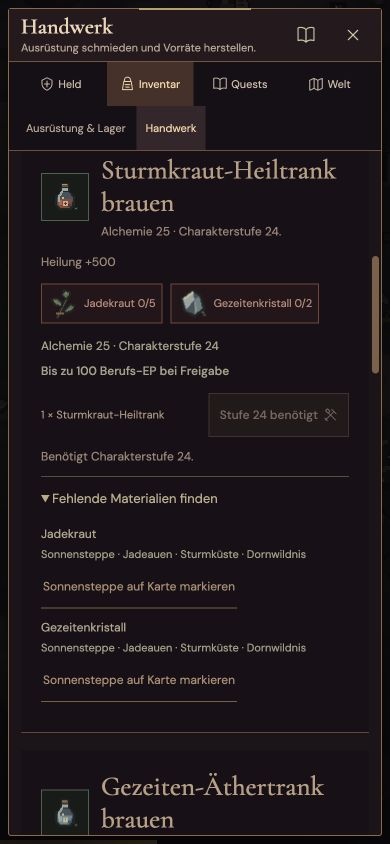
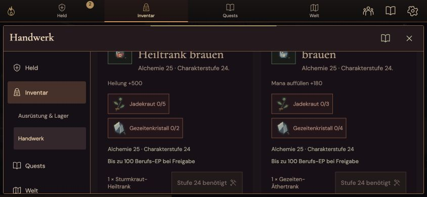

# V15: Abnahme der lernbaren Berufe

Stand: 14. Oktober 2026, Version 15.0.0. Alchemie, Schmiedekunst und Runenkunst sind mit Ausbildung, echten Herstellungsaktionen, gespeichertem Fortschritt und Meisterschaften verbunden. Die [Berufsdokumentation](professions-v15.md) beschreibt Regeln, Rezeptleiter und Materialkosten. Die [WoW-Bestandsaufnahme](wow-gap-roadmap-v14.md) bleibt eine Liste weiterer Arbeiten; eine menschlich geprüfte 200-Stunden-Kampagne ist weiterhin nicht belegt.

## Funktion und Erhalt bestehender Reisen

Die vollständige Testsuite bestand mit **1.125 bestandenen Tests**, null Fehlern und null übersprungenen Tests in 71,136 Sekunden. `npm run build` prüft die auslieferbare Browserfassung separat.

Neue Prüfungen decken die kanonischen Lehrer und Gebühren, Berufs-/Charaktergrenzen, den Erhalt aller 104 bestehenden Rezepte, regionale Materialanforderungen, erfolgreiche Herstellung, volle Taschen und Rückerstattung fehlgeschlagener Ausgaben ab. Sockelgrade, Zerlegeausgaben, Meisterschaftsboni, Statcache-Invaliderung und die Korrelation zwischen Ausbildung und gespeichertem Fortschritt sind enthalten. HTTP-/SSE-Prüfungen verwenden isolierte Konten und testen Spielertrennung, Übertragung und Wiederherstellung. Öffentliche Spielerstände sind keine Testfixtures.

Eine zusätzliche native Leiter erreichte alle drei Berufe durch zusammen 384 erfolgreiche Herstellungsaktionen auf Berufsstufe 100. Dafür wurden Charakterlevel, Gold, Lehrerposition und Zutaten ausdrücklich vorbereitet. Sie beweist die Herstellungsfunktion und exakte Zutatenabbuchung, nicht gespielte Sammelwege oder die Dauer des Fortschritts. Der zugehörige Bericht erklärt auch den zusätzlichen Quellenstahl- und Staubbedarf; eine vollständig selbstversorgende Wirtschaft wurde nicht gespielt.

## Tatsächlicher Browserweg

Ein neuer Gastcharakter auf einer getrennten lokalen Browseradresse begann auf Charakterstufe 1 mit den normalen 45 Gold. Über die sichtbare Bedienung wurden folgende Schritte ausgeführt:

1. Mit WASD zu Sera gehen und Alchemie für 20 Gold lernen.
2. Zwei gewöhnliche Kräuter aus Weltknoten sammeln.
3. Ein Feld bepflanzen, nach dessen Wachstum drei Weizen ernten und die normale Saat-Rückgabe erhalten.
4. Im Handwerksfenster Hainbrot herstellen: drei Weizen und ein Kraut wurden verbraucht; 40 Berufs-EP führten auf Alchemie 3 mit 10 von 18 EP. Der Charakter hatte anschließend 25 Gold und 37 von 92 Charakter-EP.
5. Die Seite neu laden und die gespeicherte Reise fortsetzen: Ausbildung, Alchemie 3 / 10 EP, Gold und Charakterfortschritt blieben erhalten.

Dieser Weg verwendete keine injizierten Materialien, Positionen, Lebenspunkte oder Level. Die Sammelquest wurde nicht abgeschlossen; ein kompletter Endgame-Sammelweg wurde nicht gespielt.

## Desktop und Touch

Die Browseransichten wurden bei **1280 × 720**, **390 × 844** und **844 × 390** tatsächlich geprüft. Die Dokumentbreite blieb jeweils innerhalb der Ansichtsbreite. Handwerk besitzt getrennte Berufsbereiche, Suche, Rezeptgruppe, Verfügbarkeit und höchstens acht Rezepte pro Seite. Materialien zeigen höchstens zwölf Einträge pro Seite; fehlende Zutaten öffnen Fundregionen und eine Kartenmarkierung. Die kanonischen Gegenstandsbilder erscheinen neben Ausgaben und Zutaten. Lehrerausbildung und Herstellung besitzen verständliche Sperrgründe.

Eine beim Test gefundene Anzeige zukünftiger Berufs-EP wurde korrigiert: noch gesperrte Rezepte zeigen jetzt den möglichen Ertrag bei Freigabe statt einen vom aktuellen Anfängerlimit gekürzten Wert. Verwendbare Rezepte zeigen weiterhin den tatsächlichen capbereinigten Ertrag.

Die Screenshots stammen aus dem echten Browserweg mit Alchemie 3. Höherstufige Rezepte sind deshalb erwartungsgemäß gesperrt. Die temporäre Browsergrößenänderung wird nach der Prüfung aufgehoben.

## Gemessene lokale Serverkosten

Eine Vergleichsprobe verwendete den unveränderten nativen HTTP-/SSE-Treiber aus `tests/scripts/hosting-performance-v12.mjs`: acht bewegte Spieler in einer Gruppe, fünf Sekunden Aufwärmen, 20 Sekunden Messung, zusätzlich zwei Registrierungen und zwei Logins. Die V14-Basis war der veröffentlichte Commit `53f01433db944585189fdcfd7d6f75aa05ba135a`. V15 war die geprüfte lokale Fassung. Beide Läufe verwendeten Node v24.13.1 auf macOS, Treiber und Autorität in einem Prozess, ohne CPU- oder Speicherlimit.

| Messgröße | V14 | V15 |
| --- | ---: | ---: |
| Tick P50 / P95 | 2,727 / 8,323 ms | 2,768 / 8,998 ms |
| Maximaler Tick | 25,452 ms | 31,259 ms |
| Befehlsantwort P95 | 5,384 ms | 4,067 ms |
| SSE-Abstand P95 | 85,535 ms | 85,977 ms |
| Maximaler SSE-Abstand | 103,249 ms | 117,342 ms |
| CPU-Anteil eines Kerns | 19,338 % | 20,201 % |
| Höchster RSS-Speicher | 296,391 MiB | 319,594 MiB |
| Speichern P95, je sieben Proben | 24,000 ms | 32,683 ms |

V15 enthielt 491 gemessene Ticks, 2.076 Befehle und 1.960 SSE-Abstände. Registrierungen und Logins wurden im Messfenster abgeschlossen; Cookies, zwei wiederhergestellte Kontodatensätze und ein tatsächlicher Neustart wurden geprüft. Die erzeugten Kontowelten blieben inaktiv. Es wurden keine Eingaben ausgelassen.

Die lokale Probe unterschritt die angesetzten Grenzen von 40 ms Tick, 100 ms Befehlsantwort P95 und 160 ms SSE-Abstand P95. Aus einem einzelnen Vergleichspaar wird keine Beschleunigung abgeleitet. Berufsboni werden nach Ausbildung, Rang und Meisterschaft gepuffert; die zusätzliche Funktion kostet dennoch Rechenzeit und Speicher. Diese Probe misst weder mobile Bildrate noch den gemeinsam genutzten Hetzner-Server. Die dort bereits beobachteten Burstüberschreitungen aus der [V13-Servermessung](hosting-performance-v13.md) bleiben relevant. Eine MMO-Skalierungs- oder 200-Stunden-Zusage folgt daraus nicht.

## Verbleibende Arbeit

Die neue Leiter benötigt einen gespielten Test der regionalen Materialversorgung und Lehrer-Rückwege. Für eine WoW-artige dauerhafte Welt fehlen weiterhin größere gemeinsam bespielte Welten, weiter ausgearbeitete soziale Systeme, eine geprüfte Wirtschaft und menschliche Langzeitabnahme. Die vorhandenen Mehrspieler-Raids und Konten ersetzen diese Prüfungen nicht.
