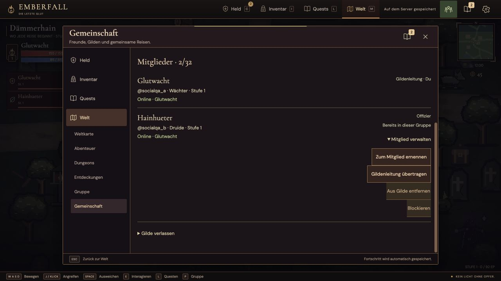
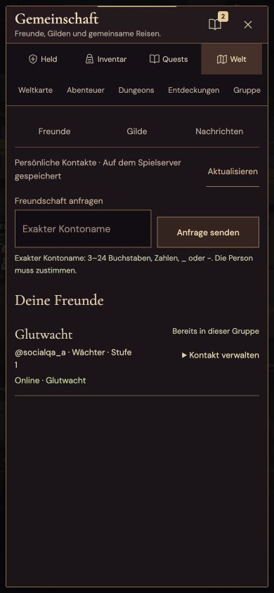
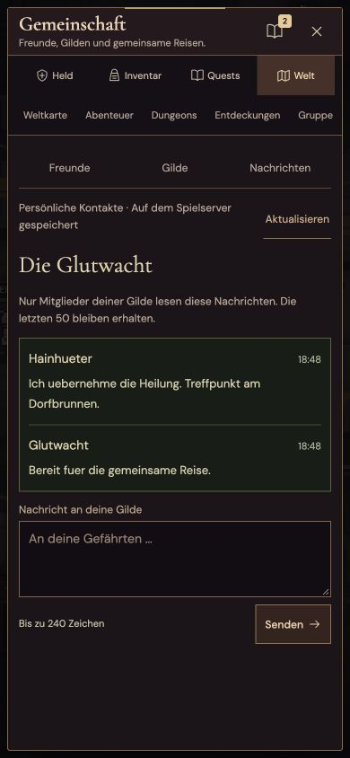
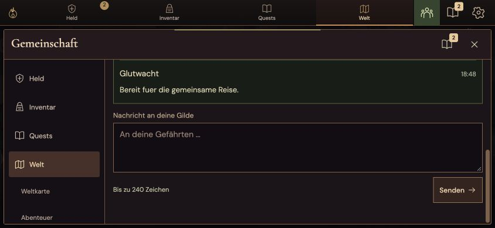

# V16: Gemeinschaft geprüft

Stand: 14. Oktober 2026, Version 16.0.0. Der Ausbau ergänzt dauerhafte, zustimmungsbasierte Kontakte und Gilden über den vorhandenen Kontenfiguren. Regeln und Grenzen stehen in der [Gemeinschaftsdokumentation](social-v16.md). Größere gemeinsame Welten, eine Spielerwirtschaft und menschlich geprüfte 200 Stunden bleiben offene Bestandteile des vollständigen Entwicklungsziels.

## Funktion, Autorität und Erhalt

Der vollständige Testlauf bestand mit **1.162 Tests**, null Fehlern und null übersprungenen Tests in 43,366 Sekunden. Anschließend wurden ausschließlich zwei kleine Darstellungsfehler korrigiert: die Ausrichtung aufgeklappter Mitgliederaktionen und die Beschriftung der Kontonamen-Eingaben. Danach bestanden nochmals 28 gezielte UI-/Konten-/Navigationsprüfungen. Elf Gegenstands-/Manifestprüfungen und `npm run build` bestanden mit der finalen Metadatenfassung.

Die neuen Prüfungen umfassen zehn Sozialfunktionsprüfungen, sieben unabhängige native HTTP-/SSE-/Speichergrenzprüfungen sowie 20 native Frontend-/Verbindungsprüfungen. Sie verwenden isolierte Spielstände. Die unabhängigen Grenzfixtures erstellen native Figuren und gültig gehashte Sitzungstokens; ihre vorbereiteten Passwortdatensätze sind ausdrücklich keine Registrierungs- oder KDF-Leistungsprobe.

Nachgewiesen sind insbesondere:

- Zustimmung zu Freundschaft und Gildeneinladung, Rollenrechte, begrenzte Listen/Historie und Blockierung.
- Strikte Ablehnung von 13 widersprüchlichen Sozialspielständen; gültige Beiträge ehemaliger Gildenmitglieder bleiben als Historie erlaubt.
- Migration eines Checkpoints ohne `social` bei Erhalt sinnvoller Charakter-, Inventar-, Quest- und Berufsfelder. Nicht gelernte Null-Talente und volatile Speicherzeitpunkte sind keine eigenständige Charakterentwicklung.
- Fehlgeschlagene Speicherung setzt Beziehungen, Rollen und Chat zurück und veröffentlicht keinen unbestätigten Zustand. Der Deployment-Validator verwendet die tatsächliche Wiederherstellung derselben Autorität.
- Logout, Sitzungsablauf und Sitzungsverdrängung beenden die zugehörigen Sozialverbindungen. Veraltete Konto-/Figurenkennungen und während eines verzögerten Requests abgemeldete Konten erhalten keine fremde Autorität.
- Persönliche, unverbundene und unberechtigte Ziele erlauben keinen Kontaktbeitritt. Ein tatsächlich verbundener Kontakt überträgt dieselbe Figur; ein Speicherfehler erhält die vorherige Welt und Gruppenzuordnung.
- Gildenfremde erhalten keine Nachrichten; nach Austritt endet der Gildenzugriff bei weiter gültiger Kontositzung.
- Separate Client-Verbindungen, schnelles Schließen/Wiederöffnen, verspätete Antworten, Kontowechsel und der Erhalt von Eingaben sind geprüft.

## Tatsächlicher Zwei-Konten-Browserweg

Zwei eigene lokale Prüfkonten wurden über reguläre HTTP-Registrierung vorbereitet und anschließend in getrennten Browserursprüngen über die sichtbare Anmeldemaske verwendet. Die Figuren blieben auf Charakterstufe 1: Wächter „Glutwacht“ und Druide „Hainhueter“. Es wurden keine Positionen, Stufen, Gegenstände, Beziehungen oder Nachrichten über Browser-JavaScript injiziert.

1. Der Wächter sendete eine Freundesanfrage; der Druide nahm sie ausdrücklich an. Die andere Ansicht aktualisierte sich ohne Neuladen.
2. Der Wächter gründete „Die Glutwacht“, lud den Druiden ein und dieser bestätigte die Einladung. Beide sahen dieselben zwei Mitglieder.
3. Beide Konten schrieben im Gildenchat. Während der Druide seine Nachricht sendete, blieb der noch ungesendete Text des Wächters unverändert und fokussiert.
4. Der Wächter erstellte eine öffentliche Gruppe. Der Druide trat über „Gruppe beitreten“ auf der Freundeskarte bei, ohne einen Gruppencode zu kopieren. Beide Gruppenanzeigen enthielten danach dieselben zwei Figuren.
5. Der Leiter ernannte den Druiden zum Offizier. Nach Neuladen und regulärem Fortsetzen beider Kontofiguren blieben Freundschaft, Gilde, Rolle, Gruppenmitgliedschaft und die zwei Nachrichten erhalten.

Dies ist eine Browser-Funktionsprobe mit zwei Konten durch einen Bediener, kein Test mit zwei unabhängigen menschlichen Mitspielern, kein Raidabschluss und keine Langzeitmessung.

## Desktop und mobile Bedienung

Tatsächlich geprüft wurden **1280 × 720**, **390 × 844** und **844 × 390**. Die Dokumentbreite überschritt jeweils die Ansichtsbreite nicht. Auf dem kurzen Querformat wurde innerhalb des bestehenden Fensters bis zur erreichbaren Texteingabe und Sendeschaltfläche gescrollt. Die temporäre Größenänderung wurde danach aufgehoben. Der Test ersetzt keine Prüfung einer echten iOS-/Android-Bildschirmtastatur.

Die während der Prüfung korrigierte Desktopausrichtung hält den Kontaktnamen neben aufgeklappten Aktionen sichtbar. Anfragen und Einladungen verlangen den Kontonamen, der als `@name` in der Kontaktkarte steht. Die Gemeinschaft belegt ein bestehendes Fenster mit drei Ansichten; sie fügt keine dauerhafte Chatfläche über dem Kampf hinzu. In beiden Browseransichten gab es am Ende keine erfassten Warnungen oder Laufzeitfehler.

## Lokaler Vergleich und Soziallast

Die unveränderte Probe `tests/scripts/hosting-performance-v12.mjs` verglich die veröffentlichte V15-Basis `99565655d3d53f820e72ccefb291ac7913aa1830` mit der eingefrorenen V16-Serverfassung. Je acht bewegte Gäste in einer Gruppe, fünf Sekunden Aufwärmen, 20 Sekunden Messung sowie zwei Registrierungen und zwei Logins. Die neue `tests/scripts/hosting-social-performance-v16.mjs` prüfte separat acht regulär registrierte Konten, alle acht Klassen, eine Gilde, acht Spiel- und acht Sozialströme und zehn Gildennachrichten im Abstand von zwei Sekunden.

Alle Läufe verwendeten Node v24.13.1 auf macOS, ohne CPU-/Speicherbegrenzung; Treiber und Autorität teilten einen Prozess. Anmeldung und Gildengründung wurden in der Sozialprobe vor der Messung abgeschlossen. Jede Figur lernte vorab über die echte API ein legales Talent mit ihren zwei Startpunkten, damit der Neustartvergleich auch tatsächlich verteilte Talentränge prüft. Es wurden weder Charakterwerte noch XP injiziert.

| Messgröße | V15: Gäste + Anmeldeburst | V16: gleiche Probe | V16: Konten + Gildenchat |
| --- | ---: | ---: | ---: |
| Tick P50 / P95 | 1,901 / 8,021 ms | 1,961 / 3,751 ms | 2,057 / 3,119 ms |
| Maximaler Tick | 23,847 ms | 21,507 ms | 14,561 ms |
| Befehlsantwort P95 | 3,655 ms | 1,310 ms | 1,551 ms |
| Spiel-SSE-Abstand P95 | 85,835 ms | 82,630 ms | 82,789 ms |
| Höchster RSS-Speicher | 247,547 MiB | 314,688 MiB | 382,703 MiB |
| CPU-Anteil eines Kerns | 14,428 % | 11,507 % | 10,525 % |
| Speichern P95 | 27,971 ms | 23,494 ms | 13,087 ms |

Die Sozialprobe maß 493 Ticks, 2.120 Befehle und 1.968 Spiel-SSE-Abstände. Alle zehn Nachrichten erreichten alle acht berechtigten Ansichten: **80 von 80 Zustellungen**, P95 **16,368 ms**, Maximum 16,432 ms. Die zehn HTTP-Chatantworten lagen bei P95 16,227 ms. 80 Sozialpakete benötigten zusammen durchschnittlich 14,186 KiB/s. Zwölf tatsächliche Speicheraktionen wurden im Messfenster erfasst. Keine Bewegungseingabe wurde ausgelassen.

Die Probe stoppte die Eingaben über die normale API, beendete ihre eigenen Server-/Verbindungsprozesse und stellte dieselben Konten aus dem privaten temporären Datenspeicher wieder her. Figurenidentität, Ausrüstung, Inventar, positive Talentränge, Berufszustände, Gildenmitglieder, Rollen und Historie stimmten vor und nach dem Neustart überein. Ein erster Lauf hatte ungelehrte Null-Ränge zu streng als unterschiedliche Entwicklung behandelt; der korrigierte Vergleich prüft positive Ränge und tatsächlich verbrauchte Talentpunkte.

Die lokalen P95-Werte unterschritten die angesetzten 40 ms für Ticks, 100 ms für Befehlsantworten und 160 ms für Spiel-SSE-Abstände. Aus einzelnen Vergleichsläufen wird keine Beschleunigung abgeleitet. Die Szenarien und Spitzen unterscheiden sich; insbesondere die acht vollständigen Konten erhöhen den Speicherbedarf. Gemessen wurde weder mobile Bildrate noch die MMO-Kapazität des gemeinsam genutzten Hetzner-Servers. Seine bekannten Burstgrenzen aus der [V13-Servermessung](hosting-performance-v13.md) bleiben gültig.
